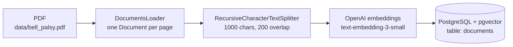
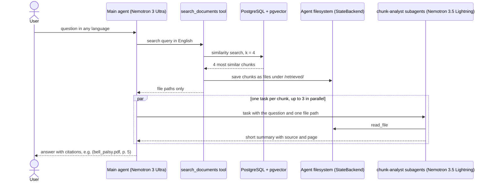

# medical-rag-agent

A [Deep Agents](https://docs.langchain.com/oss/python/deepagents/overview) agent for analyzing research on **Bell's palsy** (idiopathic facial paralysis). It answers questions using retrieval-augmented generation (RAG) over indexed medical articles. This repository is a test module for **Neuroface**.

The agent searches a PostgreSQL + pgvector knowledge base, hands each retrieved fragment to an analyst subagent and writes an answer that cites the source page. You can ask in any language, for example Polish: the agent searches in English and answers in the language of the question.

> For research and educational purposes only. This is not medical advice.

## How it works

The system has two phases. Ingestion builds the knowledge base once. The agent then answers questions against it.

### 1. Ingestion (`ingest.py`)

Run it once, and again whenever the documents change. Each run rebuilds the table from scratch.



Every chunk keeps its metadata (`source`, `page`, `start_index`), which is how answers can cite the page.

### 2. Answering a question (`main.py`)



The search tool saves the chunks to files and returns only their paths, so the main agent's context stays small. Each subagent reads one file and returns a short summary. If the summaries do not answer the question, the main agent searches again with a refined query. This is the _retrieve, offload, delegate_ pattern from the [Deep Agents RAG tutorial](https://docs.langchain.com/oss/python/deepagents/rag).

The agent remembers the conversation (messages and retrieved files) through a LangGraph checkpointer, so you can ask follow-up questions.

## Stack

| Layer                | Technology                                                                                                                  |
| -------------------- | --------------------------------------------------------------------------------------------------------------------------- |
| Language and tooling | Python 3.12, uv, pytest, ruff                                                                                               |
| Agent framework      | LangChain 1.x, Deep Agents (`deepagents`), LangGraph (`InMemorySaver` checkpointer)                                         |
| Chat models          | [OpenRouter](https://openrouter.ai): NVIDIA Nemotron 3 Ultra (main agent) and Nemotron 3.5 Lightning (subagents), free tier |
| Embeddings           | OpenAI `text-embedding-3-small` (1536 dimensions)                                                                           |
| Vector database      | PostgreSQL 18 + pgvector in Docker, `langchain-postgres` (`PGVectorStore`), psycopg 3                                       |
| Document processing  | pypdf, `langchain-text-splitters`                                                                                           |
| Configuration        | pydantic-settings, `.env`                                                                                                   |
| Observability        | LangSmith tracing                                                                                                           |

## Project structure

```
├── main.py             # terminal chat, or a single question from the command line
├── agent.py            # builds the deep agent: models, system prompt, subagent, memory
├── tools.py            # search_documents tool and the agent filesystem backend
├── prompts.py          # system prompts for the main agent and the subagent
├── ingest.py           # ingestion: load -> split -> embed -> store
├── loader.py           # PDF loader, one Document per page
├── splitter.py         # splitting pages into overlapping chunks
├── vector_store.py     # embeddings, Postgres engine, PGVectorStore
├── config.py           # settings from .env, LangSmith setup
├── docker-compose.yml  # PostgreSQL + pgvector
├── data/               # source documents
└── tests/              # pytest tests
```

## Getting started

**Prerequisites:** [Docker](https://www.docker.com/), [uv](https://docs.astral.sh/uv/), an OpenAI API key (embeddings), an OpenRouter API key (chat models) and, optionally, a LangSmith API key (tracing).

```bash
cp .env.example .env          # then fill in the API keys
docker compose up -d          # PostgreSQL + pgvector on localhost:6024
uv sync                       # install dependencies
uv run python ingest.py       # index data/bell_palsy.pdf
uv run python main.py         # start the chat
```

To ask a single question without starting the chat:

```bash
uv run python main.py "How is Bell's palsy treated?"
```

### Chat commands

| Input                             | Action                       |
| --------------------------------- | ---------------------------- |
| `new`                             | start a new conversation     |
| `exit`, `quit`, `q` or Ctrl+D     | quit                         |
| Ctrl+C while the agent is working | interrupt the current answer |

### Environment variables

| Variable             | Required     | Description                                                            |
| -------------------- | ------------ | ---------------------------------------------------------------------- |
| `OPENAI_API_KEY`     | yes          | embeddings                                                             |
| `OPENROUTER_API_KEY` | yes          | chat models for the agent and subagents                                |
| `DATABASE_URL`       | yes          | must match `docker-compose.yml` and start with `postgresql+psycopg://` |
| `LANGSMITH_PROJECT`  | yes          | LangSmith project name                                                 |
| `LANGSMITH_TRACING`  | no           | `true` to send traces to LangSmith                                     |
| `LANGSMITH_API_KEY`  | when tracing | LangSmith API key                                                      |
| `LANGSMITH_ENDPOINT` | no           | set to `https://eu.api.smith.langchain.com` for EU accounts            |

## Tests

```bash
uv run pytest
```

The tests cover the PDF loader and the splitter. Add `-s` to see `print` output.

## Limitations

- **Free model limits.** OpenRouter free models allow 20 requests per minute and 50 requests per day, or 1000 per day after buying at least 10 credits. One question takes a dozen or more model calls, so an answer can take 1-2 minutes.
- **Bibliography noise.** Reference lists can appear in search results. The analyst subagent marks them as not relevant.
- **In-memory conversations.** Chat history is lost when the program exits.

## Data source

Gardner S., Garber L., Grossi J. _Bell's Palsy: Description, Diagnosis, and Current Management._ Cureus, 2025. DOI: [10.7759/cureus.77656](https://doi.org/10.7759/cureus.77656). Licensed under [CC BY 4.0](https://creativecommons.org/licenses/by/4.0/).
